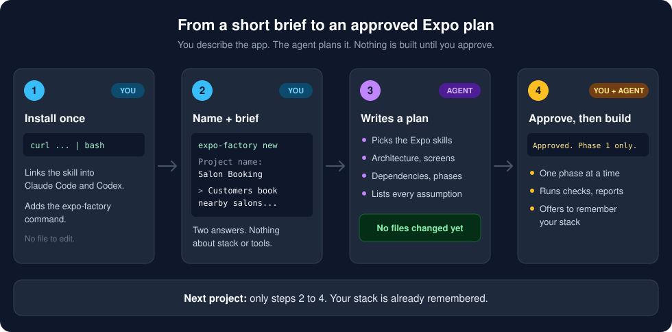

# Expo AI Project Factory

Start an Expo / React Native app by giving an AI coding agent a project name and a short brief. The agent (Claude Code or Codex) picks the right Expo skills, proposes the architecture and phases, lists every assumption it made, and waits for your approval before it writes any code.

<p align="center">
  
</p>

## Quick start

You need macOS or Linux, Git, and Claude Code or Codex.

**1. Install (once)**

```bash
git clone https://github.com/sadruddyn/expo-ai-project-factory.git
cd expo-ai-project-factory
./scripts/install.sh
```

The installer asks one question, your usual backend. Press ENTER to decide later.

**2. Add the official Expo plugin to your agent (once)**

```bash
claude plugin install expo@claude-plugins-official   # Claude Code
codex plugin add expo@openai-curated                 # Codex
```

Restart the agent afterwards.

**3. Start a project (every time)**

```bash
./scripts/new-project.sh
```

Type a project name, then describe the app and press ENTER. The script creates the project folder and offers to open your agent with the first message already sent.

That is all. There is no configuration file to fill in.

## What it looks like

### You give a name and a brief

```text
$ ./scripts/new-project.sh

Project name: Salon Booking

Describe the project in your own words, then press ENTER to submit.
(Pasting several lines at once is fine.)

> Customers browse nearby salons, pick a service and a time slot, and book. They get a reminder one hour before. Salon owners manage their slots.

--------------- Project Summary ---------------
Name:     Salon Booking
Folder:   /Users/you/Development/salon-booking
...
Create this project workspace? (y/N): y

Project workspace created successfully:
  /Users/you/Development/salon-booking

Open the project in Claude Code now? (Y/n):
```

Press ENTER and the agent opens in the new folder and starts on the plan. If you answer `n`, or no agent is found, the script prints the two things to do yourself:

```text
cd ~/Development/salon-booking && claude      (or: codex)
```

then send the agent this message:

```text
Follow FACTORY_START_HERE.md
```

### The agent sends back a plan

The plan covers the product, the Expo skills it selected, folder structure, screens, state and data, authentication, native features, dependencies with a reason for each, phases, and the commands that verify each phase. No file has been created at this point.

It ends with the part worth reading first, an **Assumptions** list. A shortened example from a real run of the brief above:

| Decision | Value | Source |
|---|---|---|
| Platforms | iOS + Android, no web | defaults file |
| Backend | NestJS REST API | defaults file |
| Data fetching | TanStack Query | proposed |
| Authentication | Email and password | proposed |
| "Nearby" | Device location, list sorted by distance, no map | inferred from brief |
| Reminder | Local notification, one hour before | inferred from brief |
| Payments | Out of scope | inferred from brief |

It may also ask up to three questions, only about choices that are expensive to change later, such as whether the backend already exists.

### What about the design?

You do not have to describe one. With nothing to go on, the agent proposes a design direction in the plan (the feel, an accent colour, light and dark mode, typography, the screens that define the look) and lists it under Assumptions.

To steer it, do any of these in the brief or in a reply:

- Say it in a sentence: "dark theme, purple accent, a feed like a photo-sharing app".
- Paste a Figma link, or add screenshots to the project folder.

Before building the whole app, the agent builds only the two or three defining screens and shows them to you. The rest is built in that style once you confirm, so a wrong look costs a few screens and not the whole app.

### You correct, then approve

Fix anything in one reply ("use phone sign-in, and add a map"), or approve:

```text
Approved. Implement Phase 1 only.
```

The agent then builds that phase, runs the checks, and reports what changed. Each later phase needs its own approval.

### It remembers your stack

After your first approval the agent asks:

```text
Save these as your defaults for future projects?
- Data fetching: TanStack Query
- Authentication: Email and password
```

Say yes and your next project starts from those choices, so you are not asked again. To change one later, tell the agent: "from now on use Supabase". To differ for one project only, say so in that project's brief.

## How the agent fills the gaps

For anything your brief does not say, the agent uses the first source that has an answer:

1. Your brief and your messages.
2. The existing project's code, if there is one.
3. Your saved defaults (`~/.config/expo-project-factory/defaults.md`).
4. What the product needs (for example, "store-distance alerts" implies location and notifications).
5. The skill's built-in defaults: Expo, TypeScript, Expo Router, iOS and Android, few dependencies.

Every choice from sources 3 to 5 appears in the Assumptions list with its source.

## Questions

**Do I have to edit a defaults file?**
No. The agent proposes what is missing and offers to save what you approve. The file is plain text if you want to read or change it.

**Will it write code without asking?**
It is instructed not to: planning never touches files, and each phase needs your approval. An instruction is not a guarantee, so keep your agent's own approval prompts switched on.

**Can I use it on an existing app?**
Yes. Open the app in your agent and say "Use the expo-project-factory skill" with what you want done. The skill inspects the project first and keeps its existing structure and conventions.

**Can I skip the script?**
Yes. In an empty folder, tell the agent:

```text
Use the expo-project-factory skill.

Project: Grocery shopping app.
Users can create shopping lists, browse stores, add products,
receive store-distance alerts, and use Siri shortcuts.

Prepare the plan and wait for my approval.
```

**Where does my project folder go?**
`~/Development/<project-name>`. Pass a different parent folder as an argument: `./scripts/new-project.sh ~/Projects/Clients`.

**Does it cost anything?**
The factory is free. You pay for your agent as usual. The skill is told not to add paid services without asking.

## Reference

<details>
<summary><b>What the installer changes on your machine</b></summary>

`./scripts/install.sh` creates:

- `~/.claude/skills/expo-project-factory`, a symlink to this repository's `factory/` folder, for Claude Code.
- `~/.agents/skills/expo-project-factory`, the same symlink for Codex.
- `~/.config/expo-project-factory/defaults.md`, your personal defaults, copied from `templates/defaults.md`.

It never overwrites anything. If a skill path already exists and is not this symlink, it stops before changing anything. An existing defaults file is kept and the backend question is skipped.

Because the skill is a symlink, `git pull` in this repository updates it.

</details>

<details>
<summary><b>The defaults file</b></summary>

`~/.config/expo-project-factory/defaults.md` holds your usual stack (platforms, state management, data fetching, styling, design direction, backend, database, authentication, storage, testing, package manager) and a few engineering preferences, such as avoiding unnecessary libraries.

- A line that says `not decided` is proposed by the agent for each project.
- The agent writes to this file only after you say yes, and only the lines you agreed to.
- Every line is yours to change or delete, by hand or by asking the agent.
- To be asked the installer's backend question again, delete the file and rerun `./scripts/install.sh`.

</details>

<details>
<summary><b>Check the installation</b></summary>

```bash
./scripts/verify.sh
```

It reports whether both skill links exist and point at this repository, whether the skill metadata is readable, and whether your defaults file exists. It cannot see inside your agent, so confirm the Expo plugin there: `/plugin` in Claude Code, `/plugins` in Codex.

</details>

<details>
<summary><b>Update</b></summary>

```bash
cd expo-ai-project-factory
git pull
./scripts/verify.sh
```

Update the Expo plugin from your agent's plugin marketplace.

</details>

<details>
<summary><b>Uninstall</b></summary>

```bash
rm ~/.claude/skills/expo-project-factory ~/.agents/skills/expo-project-factory
rm -r ~/.config/expo-project-factory
```

Then delete this repository folder. Projects you created are not affected.

</details>

<details>
<summary><b>Troubleshooting</b></summary>

**"Refusing to overwrite existing path"** during install: something else already exists at one of the skill paths, often a link to an older copy of this repository in another folder. Remove that path and rerun the installer.

**The agent does not know the skill:** restart the agent after installing, then run `./scripts/verify.sh`.

**The agent does not use Expo skills:** the official Expo plugin is missing. Install it (Quick start, step 2) and restart the agent.

**"Refusing to write into a non-empty directory":** a folder with that project name already exists and has files in it. Choose another name or another parent folder.

**The plugin install command is not recognised:** use the plugin screen inside the agent instead, `/plugin` in Claude Code or `/plugins` in Codex.

</details>

<details>
<summary><b>Run the tests</b></summary>

```bash
bash tests/run.sh          # install, verify and new-project with piped input
python3 tests/terminal.py  # new-project typed into a terminal, with fake agents
```

Both use throwaway home directories and never start a real agent. GitHub Actions runs them on macOS and Linux for every pull request.

</details>

<details>
<summary><b>What is in this repository</b></summary>

- `factory/SKILL.md`: the skill, the instructions the agent follows.
- `scripts/install.sh`, `scripts/verify.sh`, `scripts/new-project.sh`: the three commands above.
- `templates/defaults.md`: the starting defaults file.
- `templates/project-brief.md`, `templates/approval-prompt.md`: optional longer brief and ready-made approval messages.
- `tests/`: the script tests that CI runs.

The factory skill only orchestrates. Expo-specific guidance comes from the official Expo skills and documentation.

</details>

## Good to know

- The scripts are tested on macOS and Linux for every change. The skill has been tried with Claude Code; it is written for Codex as well, but that has not been tested yet.
- The skill is guidance for the agent, not enforcement. Keep approval controls enabled in your agent.
- Do not let the agent install packages, change native files, run destructive commands, or create credentials without your approval.
- Expo documentation, Expo CLI, and EAS CLI are the source of truth. The skill is supporting guidance.
